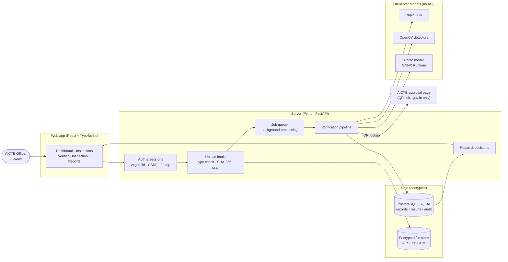
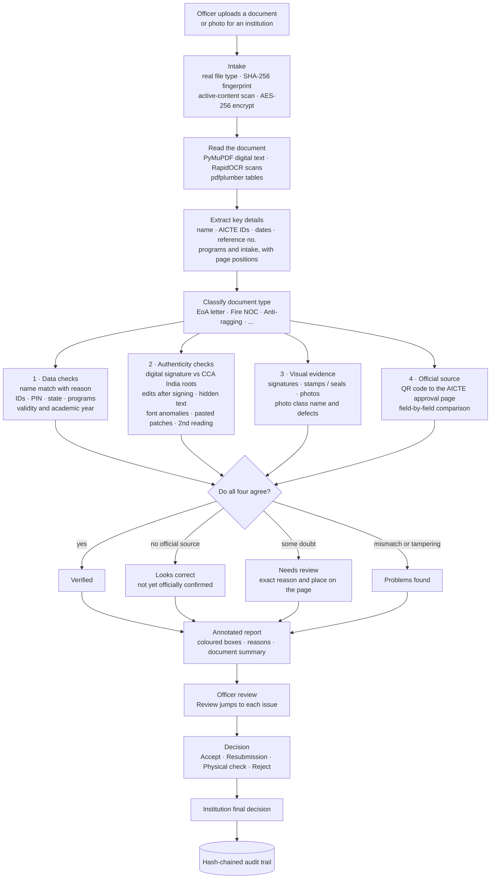
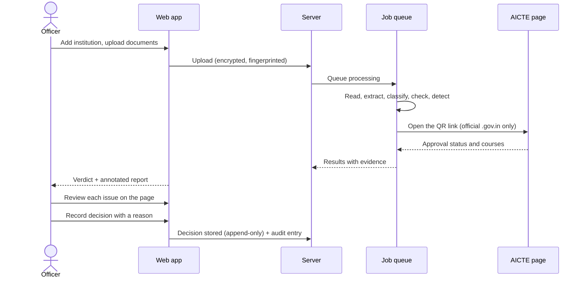

# ScanDoc — AICTE Institution Verification Platform

A web application for **AICTE officers** to verify the documents institutions submit: approval letters, NOCs, safety
certificates, committee orders and campus photographs. Each document is read, checked against the institution's record
and the official AICTE source, and examined for tampering. Signatures, stamps and photographs are located on the page.
The officer gets an annotated report with a reason for every issue and makes the final decision. Everything is
audited and runs on the server, with no outside AI service.

**Live:** https://scandoc-aicte.vercel.app

- **One role:** AICTE Officer (sign up with any email, or by invitation).
- **Five sections:** Dashboard · Institutions · Institution Verifier · Inspection & Analysis · Reports & Audit.
- **Evidence over claims:** nothing is marked *Verified* unless the document's data, its integrity and an official source all agree.

---

## How it works

### System architecture



### Verification pipeline: from upload to verdict



### Officer workflow



---

## How data is verified

A document is checked four independent ways. **It is marked *Verified* only when all four agree**; otherwise the report
shows the exact reason and where it is on the page.

| # | Check | What is compared | Tools |
|---|---|---|---|
| 1 | **Data** | Institution name (spelling variants and OCR slips tolerated; the reason is shown on mismatch), AICTE IDs, PIN code, state, trust, programs and intake, validity dates, academic year | Python rules, RapidFuzz |
| 2 | **Authenticity** | Digital signature against CCA India roots, edits after signing, revision history, hidden or covered text, key values in an unusual font, pasted patches (compression analysis), copied stamps, independent second reading | pyHanko, PyMuPDF, OpenCV, RapidOCR |
| 3 | **Visual evidence** | Signatures, stamps / seals and photographs located on each page; each photo named (classroom, laboratory, library, dustbins, fire safety equipment, ...) and checked for trained defects | OpenCV, ONNX Runtime |
| 4 | **Official source** | The QR code on AICTE letters is opened on AICTE's own approval-status page and compared field by field | httpx (official hosts only) |

Tampering indicators only count when they touch an important value (ID, date, reference number, name), so ordinary scans do not raise false alarms. The **officer always makes the final decision**.

## Security and privacy

| Area | Protection |
|---|---|
| Privacy | **Private mode:** no outside AI or API is called. All reading, checking and photo recognition runs on the server. The only outside request is the official `.gov.in` page a document's QR code links to, and no document content is sent. |
| Files | AES-256-GCM encryption at rest; originals never modified; short-lived signed download links that also need a session |
| Accounts | Argon2id password hashing, optional 2-step (TOTP) login, idle and absolute session expiry, CSRF token and origin check, sign-in rate limiting and lockout |
| Uploads | Real file-type check, size and page limits, decompression-bomb and corrupt-file rejection, active PDF content detected (never run) |
| Records | Decisions are append-only (database triggers); every action goes to a hash-chained audit trail that cannot be edited; deleted documents can be restored, and permanent erasure is logged and blocked once a decision exists |

## Tech stack

| Layer | Technology |
|---|---|
| Web app | React 19, TypeScript, Vite, React Router, Recharts |
| Server | Python 3.12+, FastAPI, Pydantic, SQLAlchemy 2, Alembic |
| Database | PostgreSQL (hosted) or SQLite (local) |
| Document reading | PyMuPDF, pdfplumber, pypdf, RapidOCR (ONNX) |
| Matching | RapidFuzz, custom name and field rules |
| Authenticity | pyHanko (PDF signatures, CCA India trust roots), OpenCV, NumPy |
| Photo recognition | Officer-trained MobileNetV3 model + general CLIP model, both via ONNX Runtime |
| Security | Argon2, cryptography (AES-256-GCM, HMAC), TOTP |
| Hosting | Vercel (web + API) with Postgres |

## Photo recognition and training your own model

Photos inside documents (and inspection photos) are named by an **officer-trained model**:
`data/models/photo_model.onnx`. It currently knows 8 classes trained from Roboflow Universe datasets: classroom,
laboratory, library, gym, dustbins, fire safety equipment, parking area, and the defect *untidy library shelves*
(97.8% accuracy on held-out photos). When it is less than 85% sure, the general model answers instead.

To add classes or defects:

```powershell
# 1. Put photos in one folder per class (or download Roboflow datasets as YOLOv8 / Folder Structure);
#    name defect folders "defect-<name>", e.g. defect-cracked_wall
# 2. Install training tools (once)
pip install torch torchvision --index-url https://download.pytorch.org/whl/cpu
pip install onnx onnxscript
# 3. Train (runs on your computer) — writes data/models/photo_model.onnx and photo_model.json
python scripts/train_photo_model.py path\to\dataset --epochs 12
```

Restart or redeploy and the app uses the new model automatically. No Roboflow or API key is needed at run time.

## Quick start (Windows, development)

Prerequisites: Python 3.12+, Node 20+.

```powershell
.\scripts\setup.ps1          # venv + Python deps, .env with generated keys, DB migrations, npm install, frontend build
cd backend
.venv\Scripts\python -m uvicorn app.main:app --port 8000
```

Open http://localhost:8000 and click **Sign up**. Settings in `backend/.env` (see `.env.example`):

| Setting | Default | Meaning |
|---|---|---|
| `PRIVATE_MODE` | `true` | Never call outside AI services |
| `ALLOW_OFFICIAL_LOOKUPS` | `true` | Allow the official `.gov.in` QR lookup |
| `SIGNUP_ENABLED` / `SIGNUP_ALLOWED_DOMAINS` | `true` / any | Self sign-up and allowed email domains |

## Deploying on Vercel

The repository deploys as one Vercel project (`index.py` + `vercel.json`): the React app is built and served by FastAPI.
Add a Postgres database from the project's **Storage** tab, set `STORAGE_ENCRYPTION_KEY`, `SECRETS_ENCRYPTION_KEY`,
`SIGNING_KEY` and `PRIVATE_MODE=true` as environment variables, and deploy. Files are stored encrypted in the
database, migrations run on start-up, and background work runs while the site is open. Uploads are limited to 4 MB per
file by Vercel.

## Tests

```powershell
cd backend; .venv\Scripts\python -m pytest            # 40 backend tests (synthetic data only)
cd frontend; npx playwright test                      # browser tests against an isolated database (docs/TESTING.md)
```

## Documentation

- [docs/VERIFICATION_METHODOLOGY.md](docs/VERIFICATION_METHODOLOGY.md): status rules, checks, limitations
- [docs/DEPLOYMENT.md](docs/DEPLOYMENT.md): production, PostgreSQL, backups, security checklist
- [docs/INTEGRATIONS.md](docs/INTEGRATIONS.md): official sources
- [docs/API.md](docs/API.md): API overview (interactive docs at `/api/docs` in development)
- [docs/TESTING.md](docs/TESTING.md): test suites and e2e setup
