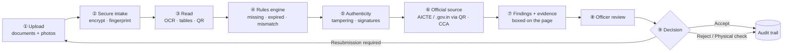
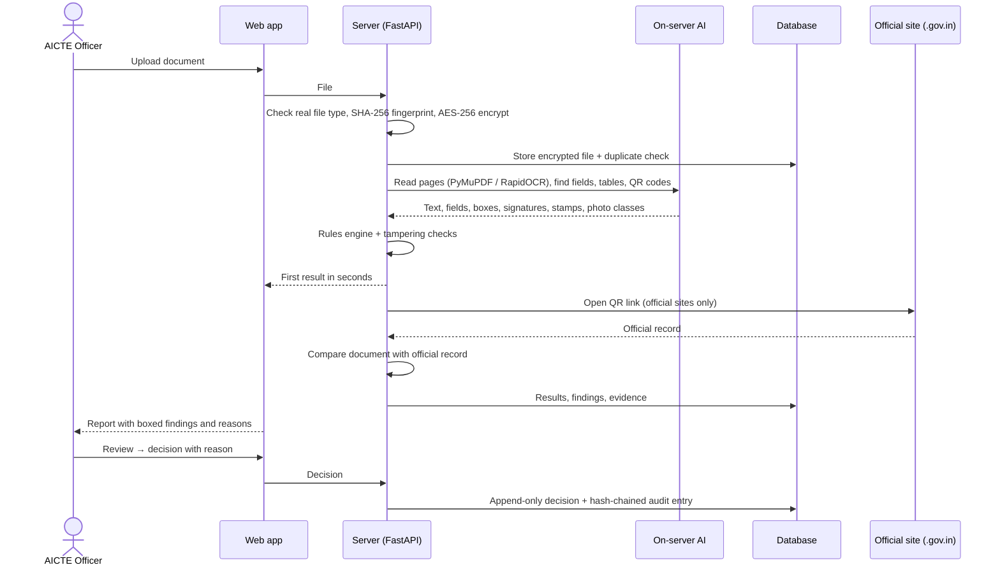
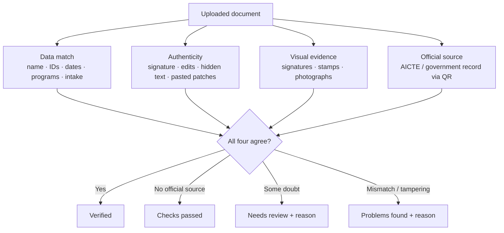
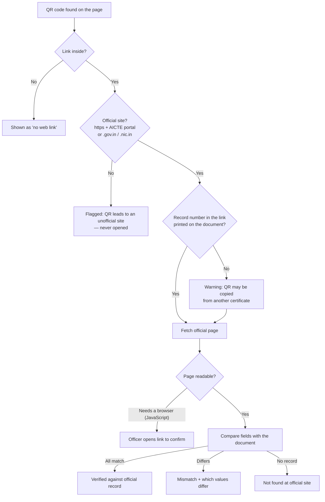
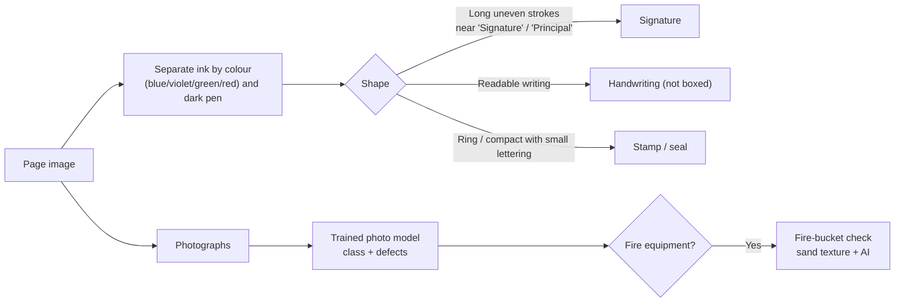
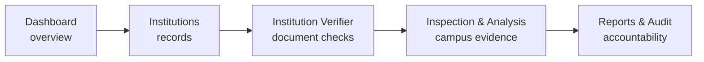
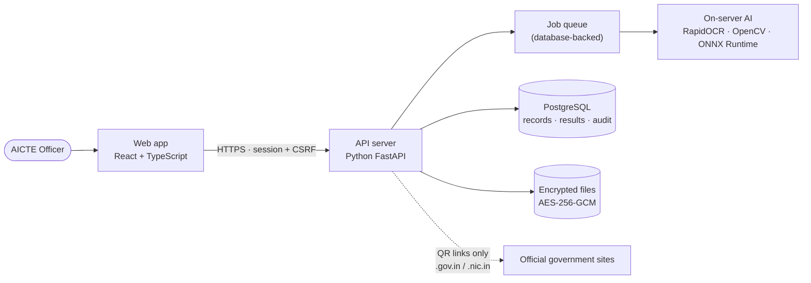

# ScanDoc — Institution Verification Platform

AI-assisted verification of the documents and campus photographs that institutions submit to **AICTE** for approval.
**The AI checks, the officer decides.**

**Live:** https://scandoc-aicte.vercel.app

- Reads approval letters, fire NOCs, food licences, anti-ragging and other documents (PDFs, scans, photos).
- Matches every detail with the institution's record, looks for tampering, locates signatures, stamps and photographs,
  and verifies QR codes and digital signatures against official government sources.
- Shows every finding as a box on the page with a plain reason; the AICTE officer reviews and records the decision.
- Private by design: all AI runs on the server, no document is sent to an outside AI service.

---

## Contents

1. [Workflow at a glance](#1-workflow-at-a-glance)
2. [How it works, step by step](#2-how-it-works-step-by-step)
3. [The four checks behind every verdict](#3-the-four-checks-behind-every-verdict)
4. [QR code verification](#4-qr-code-verification)
5. [Tampering and fake-document detection](#5-tampering-and-fake-document-detection)
6. [Signatures, stamps and photographs](#6-signatures-stamps-and-photographs)
7. [Document status rules](#7-document-status-rules)
8. [The application: five sections](#8-the-application-five-sections)
9. [System architecture](#9-system-architecture)
10. [Security and privacy](#10-security-and-privacy)
11. [Tech stack](#11-tech-stack)
12. [Model results](#12-model-results)
13. [Run it locally](#13-run-it-locally)
14. [Reference: what is implemented](#14-reference-what-is-implemented)

---

## 1. Workflow at a glance



## 2. How it works, step by step



| # | Stage | What happens | Technology |
|---|---|---|---|
| ① | **Upload** | The officer adds an institution's documents and campus photographs | React web app |
| ② | **Secure intake** | Real file type checked (not just the extension), SHA-256 fingerprint, active-content scan, duplicate check, AES-256-GCM encryption | FastAPI, cryptography |
| ③ | **Read** | Digital text with positions; scanned pages read by OCR; tables (programs, intake); QR codes and barcodes decoded | PyMuPDF, pdfplumber, RapidOCR, OpenCV |
| ④ | **Rules engine** | Name, AICTE ID, application ID, PIN, programs, intake, dates and validity compared with the institution record and AICTE Handbook rules | Python rules, RapidFuzz |
| ⑤ | **Authenticity** | Editing traces, hidden text, odd fonts, re-saved PDFs, digital-signature validation | OpenCV, PyMuPDF, pyHanko |
| ⑥ | **Official source** | QR links opened only on AICTE / government sites and compared field by field; signed PDFs checked against CCA India roots | httpx, pyHanko |
| ⑦ | **Findings + evidence** | Every issue boxed at its exact spot with a plain-language reason | React (annotated report) |
| ⑧ | **Officer review** | **Review** jumps straight to each flagged spot | React |
| ⑨ | **Decision** | Accept · Resubmission required · Physical check · Reject, with a reason; saved append-only and audited | PostgreSQL, audit log |

Processing runs in two stages so the officer is never kept waiting: the main result appears within seconds, and a
deeper second reading of the pages finishes in the background and updates the report.

## 3. The four checks behind every verdict



**Data match** — names are compared word by word (case-insensitive, `SREE`/`SHRI`/`SRI` treated alike). On a
mismatch the reason says exactly which words differ, e.g. *"The document names 'SREE RAMA ENGINEERING' but the
institution record is 'SHRI RAMDEOBABA COLLEGE OF ENGINEERING AND MANAGEMENT' … this looks like a different
institution's document."*

**Duplicate / reused files** — every file's SHA-256 fingerprint is compared with all earlier uploads. A file already
submitted by another institution fails the check and names that institution.

## 4. QR code verification



- **Every** QR code on every page (up to 30 pages) is read; each box on the page says where the QR leads
  (e.g. *AICTE (approvalstatus.aicte.gov.in)*, *FSSAI (foscos.fssai.gov.in)*) and whether that is an official site.
- AICTE approval-letter QR codes are compared field by field with AICTE's own record — name, IDs, address, programs,
  intake and approval status.
- The official page is stored encrypted with its fingerprint and time, so the officer can show later what the
  government site said on that day.
- Typed links on the page are not opened automatically; only links inside QR codes are followed, and only to
  official sites.

## 5. Tampering and fake-document detection

| Trick | How ScanDoc catches it |
|---|---|
| Text or numbers changed and pasted on a scan | **Error-level analysis** — an edited patch compresses differently; shown as a heatmap |
| Signature or stamp copied from elsewhere on the page | **Copy-move detection** — matching regions are found and both are boxed |
| Text covered and retyped in a PDF | **Hidden-text check** — the visible page is re-read and compared with the PDF's text layer |
| Different font on dates or amounts | **Font check** on key values |
| PDF edited after it was created or signed | **Revision check** and digital-signature coverage |
| Fake digital signature | **pyHanko** validation against the **CCA India** root certificates (2014, 2015, 2022, 2022 SPL) |
| Same file reused by another college | **SHA-256 fingerprint** duplicate check |
| Fake details | Data match with the institution record + official record via QR |

Indicators are graded by significance; only those on key values (name, IDs, dates, intake) raise the document's
status, so ordinary stamps, photographs and highlighter do not cause false alarms.

## 6. Signatures, stamps and photographs



- **Signatures and stamps** are located on scans with OpenCV and boxed; if none is present, nothing is boxed.
  For digitally signed PDFs the signature itself is verified cryptographically (see §5).
- **Photographs** are named by the trained photo model — classroom, laboratory, library, gym, dustbins, fire safety
  equipment, parking area — and checked for defects (e.g. *untidy library shelves*).
- **Empty fire buckets**: when a photo shows fire equipment, each red bucket on a rack is located and its opening is
  checked for sand. Buckets with no sand are boxed as *"Possible defect: Empty fire buckets — verify on site"*, with
  the reason.
- If the trained model is unsure, a general image model (CLIP) gives the closest description instead.

## 7. Document status rules

| Status | When |
|---|---|
| **Verified** | Official source confirms the document (e.g. AICTE record via QR) and no problem was found |
| **Checks passed** | All checks passed but no official source was available for this document |
| **Needs review** | Something needs a human look (unclear scan, possible defect, QR could not be compared) |
| **Problems found** | Mismatch with the record or official source, tampering on key values, wrong institution, reused file |
| **Analysing** | Still being processed |

The AI never rejects anything by itself — every status is advice with evidence; the officer decides.

## 8. The application: five sections



| Section | What it contains |
|---|---|
| **Dashboard** | Cards: institutions, documents correct, documents with problems, awaiting your decision, decisions recorded, being analysed · institutions table (problems first) · document-results chart · recent activity (uploads, problems found, decisions) |
| **Institutions** | Directory · each institution's details, documents, programs and approved intake, year-to-year comparison, discrepancies, corrective actions, inspections, activity · approve / return for corrections / reject |
| **Institution Verifier** | Verification cases · documents and their annotated reports · document requirements · official sources · document categories |
| **Inspection & Analysis** | Inspections with photo/video evidence · AI findings (resolve / dismiss) · corrective actions with due dates · inspection checklist |
| **Reports & Audit** | Filterable reports (CSV / PDF) · hash-chained audit trail · background jobs with retry · integration status |

The top bar has notifications (processing complete, official-check results) and the account menu (profile, 2-step
verification, officer accounts, sign out).

## 9. System architecture



On Vercel the API runs as a serverless function, files are stored encrypted in PostgreSQL (Neon), and queued work
is run by short requests from the web app. Locally it runs with SQLite and in-process worker threads.

## 10. Security and privacy

- **Private mode** — the server refuses every outgoing request except official `.gov.in` / `.nic.in` sites opened
  from QR codes; no document text or image goes to an outside AI service.
- **Encryption** — every file AES-256-GCM encrypted at rest; download links are HMAC-signed, short-lived and also
  require a session.
- **Accounts** — Argon2id passwords, optional TOTP 2-step verification, login throttling and lockout, CSRF protection,
  idle and absolute session expiry.
- **Tamper-proof records** — decisions are append-only (enforced by database triggers); every action is written to a
  SHA-256 hash-chained audit log that can be verified end to end.
- **Human in control** — the AI only advises, with evidence; officers make every decision, with a reason.

## 11. Tech stack

| Layer | Used |
|---|---|
| Frontend | React 19, TypeScript, Vite, Recharts |
| Backend | Python, FastAPI, SQLAlchemy, Alembic |
| Reading | PyMuPDF, pdfplumber, RapidOCR (PaddleOCR models) |
| Vision | OpenCV; MobileNetV3 photo model (trained with PyTorch on college datasets in YOLOv8 export format) and CLIP, both via ONNX Runtime |
| Matching | RapidFuzz |
| Verification | AICTE approval portal and government pages via QR (httpx); pyHanko + CCA India root certificates |
| Database | PostgreSQL (Neon) in production, SQLite locally |
| Security | AES-256-GCM, Argon2id, TOTP, HMAC-signed links, hash-chained audit log |
| Hosting | Vercel |

## 12. Model results

Trained photo model (MobileNetV3), evaluated on 315 held-out photos (20% of 1,576):

| Metric | Score |
|---|---|
| Accuracy | **98.1%** |
| Precision (macro) | **96.6%** |
| Recall (macro) | **97.6%** |
| F1 score (macro) | **97.1%** |

| Class | Test photos | Precision | Recall | F1 |
|---|---|---|---|---|
| Classroom | 11 | 91.7% | 100% | 95.7% |
| Dustbins | 87 | 100% | 100% | 100% |
| Fire safety equipment | 55 | 100% | 96.4% | 98.1% |
| Gym | 54 | 100% | 100% | 100% |
| Laboratory | 34 | 100% | 100% | 100% |
| Library | 27 | 89.7% | 96.3% | 92.9% |
| Parking area | 22 | 100% | 100% | 100% |
| Untidy library shelves (defect) | 25 | 91.7% | 88.0% | 89.8% |

For comparison, the general CLIP model alone reaches 66.5% accuracy on the same photos (6 classes it can name).
The held-out photos were also used to pick the best training round, so these figures are slightly optimistic.

The empty-fire-bucket check was set on a small set of photos (one rack of empty buckets, sand-filled racks and 230
fire-safety photos, with no false alarms among them); it is reported as a possible defect to verify on site.

Retrain with your own photos: `python scripts/train_photo_model.py path/to/dataset` (one folder per class; folders
named `defect-<name>` are reported as defects).

## 13. Run it locally

Prerequisites: Python 3.12+, Node 20+, FFmpeg on `PATH` (needed for video).

```powershell
.\scripts\setup.ps1          # venv + Python deps, .env with generated keys, DB migrations, npm install, frontend build
cd backend
.venv\Scripts\python -m app.cli create-officer --email you@example.gov.in --name "Your Name"   # prompts for password
cd ..
.\scripts\dev.ps1            # API on :8000, web app on http://localhost:5173
```

Or serve the built UI from the API alone: `cd backend; .venv\Scripts\python -m uvicorn app.main:app --port 8000` and
open http://localhost:8000.

Anyone can create an account from **Sign up** on the login page (e.g. with Gmail). Set `SIGNUP_ALLOWED_DOMAINS` to
limit sign-up to certain domains, or `SIGNUP_ENABLED=false` to turn it off. Further officers are invited from the
account menu → **Officer accounts**.

`PRIVATE_MODE=true` (the default in `.env.example`) keeps all processing on the server. An optional outside vision
workflow can be configured with `ROBOFLOW_API_KEY` only when private mode is off.

### Tests

```powershell
cd backend; .venv\Scripts\python -m pytest            # backend tests (synthetic fixtures only)
cd frontend; npx playwright test                      # browser test against an isolated e2e database — see docs/TESTING.md
```

## 14. Reference: what is implemented

| Area | Implementation |
|---|---|
| Auth | Argon2id passwords, DB-backed sessions (HttpOnly, SameSite=Strict, Secure in production), 30-min idle / 8-h absolute expiry, CSRF token + Origin check, login throttling and lockout, optional TOTP MFA, password reset, invitations, session revocation |
| Storage | Every file AES-256-GCM encrypted at rest; originals never modified; renders, processing copies and evidence stored separately; short-lived HMAC-signed file links that also require a session |
| Uploads | Extension + magic-byte checks, size and page limits, corrupted-file and decompression-bomb rejection, password-protected PDF handling, active-content detection (never executed), optional ClamAV scan, SHA-256 duplicate detection, versioning, remove / restore / delete |
| Extraction | PyMuPDF text with coordinates, pdfplumber tables, local RapidOCR for scans (per-line boxes + confidence), program/intake table parsing, field provenance (page, bbox, method, source text) |
| Validation | Expected fields, identifier formats, academic-year logic, date consistency, stated-validity expiry, registry identity match with reasons, programs/intake vs registry, table totals, unreadable/blank pages, duplicates (naming the other institution), internal contradictions |
| Official records | Every QR link on official sites (AICTE approval-status page compared field by field incl. course intakes; other `.gov.in` / `.nic.in` issuer pages); QR record number must appear on the document; configurable REST adapter for authorised APIs; officer-recorded checks with evidence |
| Integrity | SHA-256 re-verification, PDF signature validation (pyHanko + CCA India roots), revision history, metadata, hidden text, font anomalies on numbers, rendered-vs-embedded comparison, error-level analysis with heatmaps, duplicated-region detection, signatures / stamps / photographs, QR source and official-site check |
| Photo AI | Trained MobileNetV3 classes and defects, CLIP fallback, empty-fire-bucket check — all on the server via ONNX Runtime |
| Cross-document | Identity, IDs, academic year, trust, establishment year, PIN and per-course intake compared across a case's documents with links to sources |
| Requirements | Registry seeded from APH 2024-27 Annexure-1 §1.1 and Annexure-2 §2.1 with clause/page/excerpt; marked unconfirmed until an officer confirms |
| Inspection | Image upload/EXIF, video validation (FFprobe), FFmpeg sampling with true timestamps, boxes drawn from real model output, tracking, officer confirm/reject/correct (originals preserved), checklist assessments, corrective actions |
| Decisions & audit | Append-only decisions (DB triggers) with idempotency keys and supersede-based corrections; hash-chained append-only audit trail with verification |
| Reports | Institutions, documents, pending cases, discrepancies, inspections, corrective actions, decisions, officer activity, integration status, audit — JSON preview, CSV (formula-injection safe), PDF |
| Jobs | DB-backed queue with leases, retries/backoff, timeouts, idempotency keys, progress, manual retry; request-driven mode for serverless hosting |

## Documentation

- [docs/ARCHITECTURE.md](docs/ARCHITECTURE.md) — core architecture, pipeline and charts
- [docs/VERIFICATION_METHODOLOGY.md](docs/VERIFICATION_METHODOLOGY.md) — status rules, checks, limitations
- [docs/INTEGRATIONS.md](docs/INTEGRATIONS.md) — configuring official sources and inference models
- [docs/DEPLOYMENT.md](docs/DEPLOYMENT.md) — production, PostgreSQL, backups, security checklist
- [docs/API.md](docs/API.md) — API overview (interactive docs at `/api/docs` in development)
- [docs/TESTING.md](docs/TESTING.md) — test suites and e2e setup
- [docs/PENDING_INTEGRATIONS.md](docs/PENDING_INTEGRATIONS.md) — what is still needed (APIs, models, checklists)
