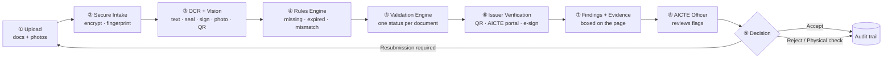
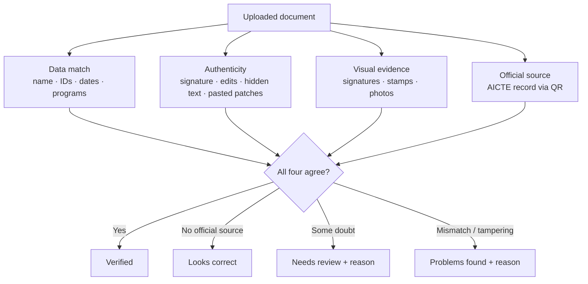
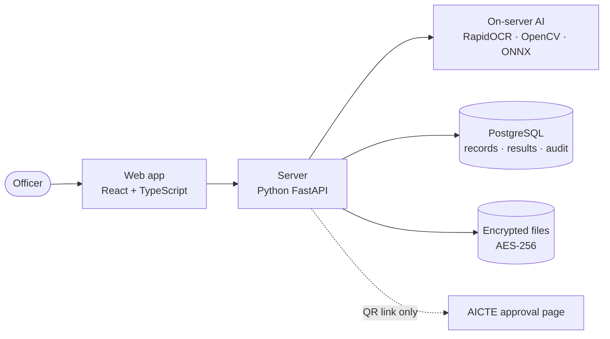

# Docura — Core Architecture

AI-assisted verification of AICTE institution documents. **AI checks, the officer decides.**

---

## 1. Workflow at a glance

## 2. Pipeline in detail

| # | Stage | What happens | Technology |
|---|---|---|---|
| ① | **Upload** | Officer adds an institution's documents and campus photos | React web app |
| ② | **Secure Intake** | Real file type checked, SHA-256 fingerprint, active-content scan, AES-256 encryption | FastAPI, cryptography |
| ③ | **OCR + Vision** | Text read from PDFs and scans; signatures, stamps, QR codes and photos located; photos named | PyMuPDF, RapidOCR, OpenCV, ONNX Runtime |
| ④ | **Rules Engine** | Name, AICTE IDs, PIN, programs, dates and validity compared with the college record and Handbook rules | Python rules, RapidFuzz |
| ⑤ | **Validation Engine** | Tampering checks plus all results combined into one status | pyHanko, PyMuPDF, OpenCV |
| ⑥ | **Issuer Verification** | QR opened on AICTE's approval page; digital signature checked against CCA India roots | httpx, pyHanko |
| ⑦ | **Findings + Evidence** | Every issue boxed at its exact spot with a plain reason | React (annotated report) |
| ⑧ | **Officer Review** | "Review" jumps straight to each flagged spot | React |
| ⑨ | **Decision** | Accept · Resubmit · Physical check · Reject, with a reason | PostgreSQL, hash-chained audit log |

## 3. The four checks behind every verdict

## 4. System components

## 5. Tech stack

| Layer | Used |
|---|---|
| Frontend | React 19, TypeScript, Vite, Recharts |
| Backend | Python, FastAPI, SQLAlchemy |
| OCR & reading | RapidOCR (PaddleOCR models), PyMuPDF, pdfplumber |
| Vision | OpenCV; MobileNetV3 photo model (trained with PyTorch on Roboflow datasets) + CLIP, via ONNX Runtime |
| Verification | AICTE approval portal (QR), pyHanko + CCA India roots |
| Database | PostgreSQL (Neon), SQLite locally |
| Security | AES-256-GCM, Argon2, CSRF, 2-step login, hash-chained audit log |
| Hosting | Vercel |

## 6. Security and privacy

- **Private mode:** no outside AI or API; the only outside call opens the official `.gov.in` page from a QR code.
- **Encrypted files:** AES-256 at rest; download links are signed and expire.
- **Tamper-proof records:** decisions are append-only; every action is in a hash-chained audit log.
- **Human in control:** every flag is advice with evidence; the officer makes the final decision.

## 7. Results from the prototype

- Photo model: **97.8% accuracy** on 315 unseen photos (8 classes).
- 12 institutions, 12 AICTE approval letters; **7 verified live** against AICTE's portal.
- Document result shown in seconds; deeper second reading runs in the background.
